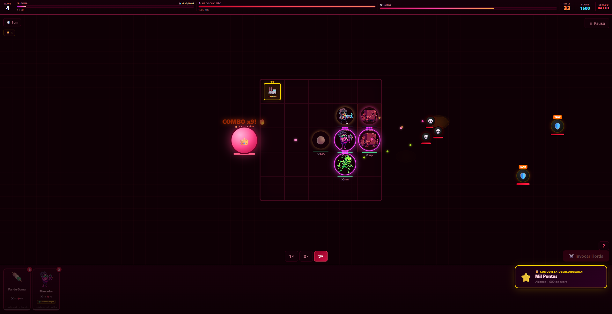
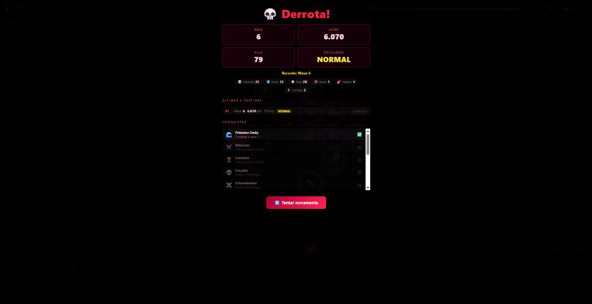
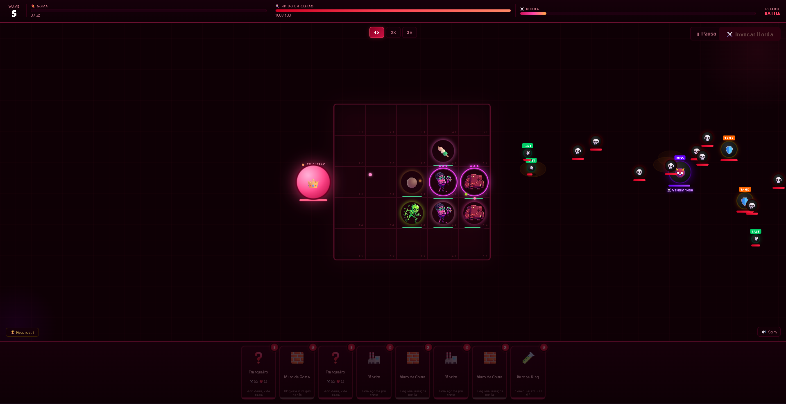

# Reino do Chicletão 🍬

## Screenshots

### Gameplay — Combo x9 e conquista desbloqueada


### Tela pós-partida — Stats, histórico e conquistas


### Boss


---

## Descrição

Jogo de tower defense baseado em cartas: defenda o Rei Chicletão posicionando tropas num grid 5x5 contra hordas de inimigos (Venom). Gerencie sua goma, invoque unidades, sobreviva o maior número de waves possível e tente bater seu recorde.

Desenvolvido como Trabalho de Conclusão de Curso (TCC) — ETEC Desenvolvimento de Games 2D/3D.

---

## Como executar

Abra o arquivo `Jogo.html` em um navegador moderno (Chrome/Edge/Firefox). Não requer servidor — basta dar duplo-clique no arquivo.

A arena escala automaticamente para qualquer tamanho de janela, zoom do navegador ou celular (no celular, jogue na horizontal).

> ⚠️ Mantenha `Jogo.html`, `script.js`, `style.css` e a pasta `assets/` juntos, com a mesma estrutura do projeto.
>
> O script é um arquivo clássico (não usa módulos ES) justamente para funcionar com duplo-clique, sem servidor.

---

## Controles

| Ação | Controle |
|---|---|
| Selecionar carta | Clique na carta da **bandeja**, ou teclas **1–9** (e **0** para a 10ª carta). **Esc** cancela a escolha |
| Abrir/fechar a bandeja de cartas | Botão **▲ CARTAS** / aba **▼ Fechar**, ou tecla **C** |
| Bandeja automática (liga/desliga) | Botão **↻ Automática** na bandeja, ou tecla **B** |
| Modo apresentação (letras maiores) | Botão **🖥** ou tecla **T** |
| Tela cheia | Botão **⛶** ou tecla **F** |
| Posicionar tropa | Clique numa célula do grid |
| Fazer upgrade de tropa | Clique na célula com a mesma carta |
| Iniciar wave | Botão **Invocar Horda** ou **Enter** |
| Usar Xarope King / Puxada de Goma | Clique na carta (efeito imediato, não precisa de célula) |
| Usar Derretimento | Selecione a carta e clique na **tropa** que quer sacrificar |
| Descartar carta (+3 goma) | Botão **🗑 Descartar** ou tecla **D** — com uma carta selecionada, descarta ela na hora; sem seleção, liga o *modo descarte* (clique nas cartas ou teclas **1–0**; **Esc** sai) |
| Pausar | **P** ou **Espaço** |

### Interface para telão (v5)

Tudo (HUD, grid, botões e cartas) fica dentro de um palco 960×540 escalado para a tela inteira, então as letras crescem junto com o projetor (as letras do HUD e das cartas têm de 10 a 24 px lógicos, e o palco é ampliado até ~1,8× num telão 1080p; no modo apresentação crescem mais 22%).

- **Bandeja de cartas:** sobe sozinha no preparo, com cartas grandes e um painel de detalhes (nome, custo, dano, vida, passiva). Ao escolher uma carta ela **desce** para mostrar o grid inteiro, e **sobe de novo** depois de usar. Na batalha ela some e a tela fica limpa.
- **Descarte:** é um espaço do tamanho de uma carta dentro da bandeja.
- **Modo apresentação (T):** letras e barras ainda maiores e mais contraste. A escolha fica salva.
- **HUD no topo:** wave, goma, HP, horda, kills, score e fase, mais os botões de som, pausa, legenda, apresentação e tela cheia.

---

## Mecânicas de jogo

### Tropas (cartas de unidade)
| Carta | Custo | Passiva |
|---|---|---|
| Mascador 🍬 | 2 | Regenera HP das tropas vizinhas |
| Chicle Ácido 🍋 | 2 | — |
| Blocão 🛡 | 4 | **Taunt** — inimigos priorizam ele |
| Franqueiro 🎯 | 3 | **Crítico** — 20% chance de dano duplo |
| Par de Goma 🍡 | 2 | — |
| Rei da Bala 🍮 | 4 | Lendário (raridade especial) |
| Goma Grudenta 🟤 | 5 | Lentifica inimigos automaticamente |
| Chicle Cura 💚 | 3 | Cura tropas aliadas próximas |

### Tipos de inimigo
| Inimigo | Comportamento |
|---|---|
| Normal 💀 | Padrão |
| Tank 🛡️ | Muito HP, lento |
| Fast 💨 | Pouco HP, muito rápido |
| Boss 👹 | Entra em fúria a 40% HP, se divide em 3 ao morrer |
| Curador 💊 | Heala aliados próximos — prioridade de abate |
| Corredor 🏃 | Ignora tropas, vai direto no Rei (wave 6+) |
| Armado 🪖 | Primeiro hit quebra o escudo (wave 8+) |

### Outros sistemas
- **Sinergias** — quanto mais tropas no grid, maior o bônus de dano coletivo
- **Combo** — matar 3+ inimigos seguidos ativa multiplicador de score
- **Descarte 🗑** — na fase de preparo, qualquer carta da mão pode ser descartada: ela some e você ganha **+3 goma por carta**, não importa qual carta seja (nem se você tem goma para pagá-la). A goma nunca passa do máximo, e o descarte libera espaço na mão (limite de 10 cartas). Configurável em `DISCARD_GOMA` no `script.js`.
- **Fábrica 🏭** — gera goma extra por wave
- **Loja** — aparece a cada 3 waves para comprar itens com goma
- **Upgrades pós-wave** — escolha 1 de 3 power-ups ao fim de cada wave
- **Eventos especiais** — Horda Dupla (wave 7, 14…), Horda Veloz (wave 6, 12…), Curador em campo (wave 4, 8…). Boss a cada 5 waves.
- **Conquistas** — 12 conquistas salvas localmente com toast animado
- **Histórico** — últimas 5 partidas salvas com wave, score e kills
- **Vitória 🏆** — derrote a wave 15 (Fácil), 20 (Normal) ou 25 (Difícil) para vencer; depois dá para continuar no modo infinito. Vitórias por dificuldade ficam salvas, e há conquistas de vitória.
- **Dificuldades** — Fácil, Normal e Difícil selecionáveis no menu (a última escolha fica salva). O Fácil também dá +3 goma por wave e as waves finais crescem mais devagar; os valores ficam em `BALANCE.difficulty` (`late` e `goma`)
- **Prévia da wave** — antes de invocar a horda, o canto da arena mostra quantos inimigos vêm e se há boss ou evento
- **Alerta de HP baixo** — borda vermelha pulsando quando o Rei está abaixo de 30%
- **Dicas da 1ª partida** — 3 dicas rápidas que aparecem uma única vez
- **Mão inicial justa** — sempre começa com pelo menos 3 tropas

---

## Velocidade

Use os botões **1× 2× 3×** na arena para acelerar o jogo.

---

## Balanceamento e simulador

Todos os números das waves (quantidade, HP, dano, velocidade e multiplicadores de dificuldade) estão no objeto
`BALANCE`, no começo do `script.js`. Para testar mudanças sem jogar na mão, existe um simulador que roda o
**`script.js` real** (sem copiar regras) com bots de várias estratégias — precisa só de Node 18+:

```bash
node tools/simulate.js                                   # tabela completa (demora alguns minutos)
node tools/simulate.js --games 6 --maxwave 20            # rápido, serve de teste de fumaça
node tools/simulate.js --diff hard --strategy balanced --trace   # mostra HP do Rei e nº de tropas wave a wave
node tools/simulate.js --set difficulty.hard.hp=1.2      # testa um número sem editar o jogo
```

A tabela mostra a coluna **VENCE** (% de partidas que derrotam a wave de vitória). As partidas são determinísticas (mesma seed = mesmo resultado), então dá para comparar antes/depois de uma mudança.
Estratégias: `naive` (iniciante), `casual` e `casual2` (imitam um jogador humano: 1º power-up, sem loja), `spam`, `balanced`, `eco`, `tank`, e `balanced_d` / `balanced_d1` (o `balanced` usando o descarte, mantendo 3 ou 1 carta na mão). O relatório mais recente está em
[`docs/balance-report.md`](docs/balance-report.md).

> Os bots são aproximações: servem para comparar versões e achar problemas grosseiros (como "Difícil mata na wave 1"),
> não para prever exatamente o que um jogador humano faria.

---

## Estrutura do projeto

```
chico-cletus_game-main/
├── Jogo.html               — estrutura HTML da página
├── script.js               — lógica completa do jogo
├── style.css               — estilos e animações
├── assets/                 — sprites das tropas (WebP)
│   ├── chicleteMascador.webp
│   ├── chicleteAcido.webp
│   ├── chicleteTanque.webp
│   └── Franqueiro.webp
├── docs/                   — screenshots, arte de referência e relatório de balanceamento
├── tools/
│   └── simulate.js         — simulador de balanceamento (bots jogam o jogo real)
└── README.md
```

---

## Tecnologias

- HTML5, CSS3, JavaScript puro (sem frameworks ou bibliotecas)
- Renderização via DOM (sem Canvas)
- Web Audio API para efeitos sonoros procedurais
- localStorage para high score, conquistas, histórico de partidas e última dificuldade escolhida (com fallback seguro se o storage estiver indisponível)

---

## Equipe

Desenvolvido por Raul Pinheiro das Chagas (R7Chaca) e Marcelo Gomes Barbosa — ETEC, 2026.

---

## Licença

MIT
